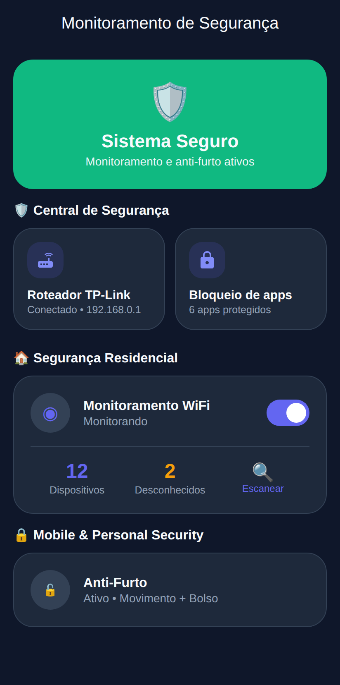
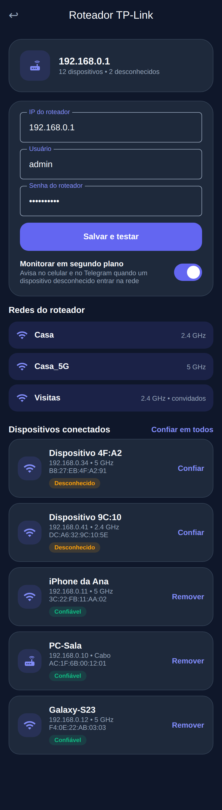
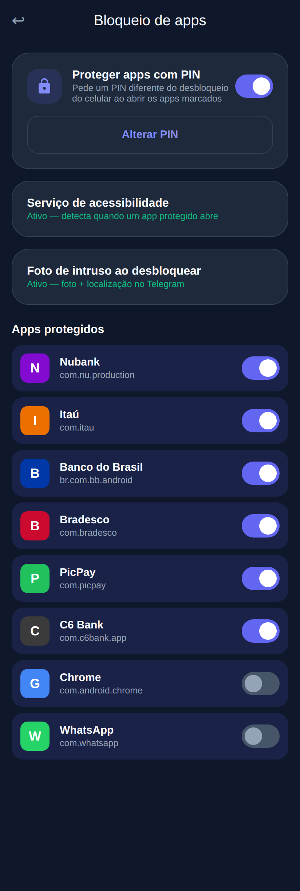
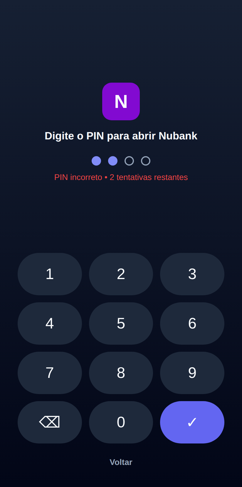
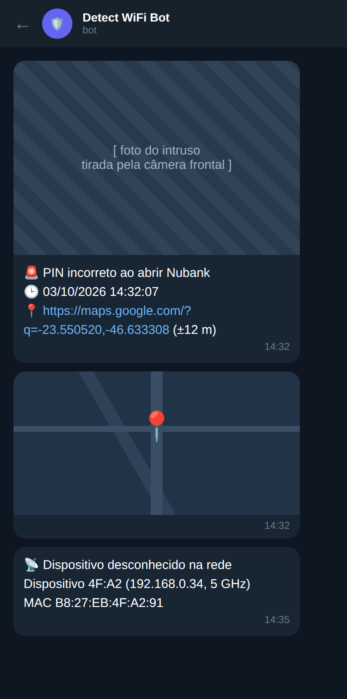

# Presence Detector & Segurança Anti-Furto

[](https://github.com/juninmd/detect-wifi/actions/workflows/main.yml)
[](https://github.com/juninmd/detect-wifi/actions/workflows/validate.yml)

App Android (Kotlin) que combina detecção de presença residencial (Wi-Fi/Bluetooth/câmera) com proteção anti-furto,
mais um sensor passivo opcional (ESP32 + backend Node/TypeScript) que enxerga aparelhos próximos mesmo sem estarem
conectados ao roteador. Alertas saem por notificação local e Telegram.

## Componentes

| Pasta | O que é | Stack |
|-------|---------|-------|
| `app/` | App Android principal (módulo Gradle `:app`) | Kotlin 2.4.21, AGP 9.3.1, JDK 21 |
| `backend/` | API do sensor de presença (`/health`, `/sightings`, `/presence`) | Node 20+, TypeScript, SQLite (`better-sqlite3`), Jest |
| `firmware/esp32-sniffer/` | Sketch Arduino do ESP32 que envia probe requests ao backend | Arduino IDE, placa "ESP32 Dev Module" |
| `mobile/` | Esqueleto Flutter (só camada `lib/domain` e `main.dart`) | Dart SDK `^3.11.0` |
| `docs/` | Documentação do sensor (`PRESENCE_SNIFFER.md`) e prévias das telas (`preview/`) | |

## Recursos

### Monitor de presença residencial
*   **Radar Wi-Fi:** presença por flutuação de sinal.
*   **Scanner Bluetooth:** detecção secundária via BLE.
*   **Câmera:** detecção visual de presença.
*   **Alertas remotos:** notificações via Telegram.

### Segurança móvel (anti-furto)
*   **Alarme de movimento**, **modo bolso**, **guarda de carregador**.
*   **Desarme biométrico** (AndroidX Biometric) para parar o alarme.
*   **Selfie de intruso** após tentativa errada de desbloqueio.

### Roteador, bloqueio de apps e foto de intruso
*   **Roteador TP-Link:** lista redes e dispositivos conectados (Archer/Deco, API web criptografada), marca "confiáveis" e
    avisa quando um desconhecido entra. A senha fica cifrada com o Android Keystore. O acesso é HTTP local: os IPs
    `192.168.0.1`, `192.168.1.1`, `192.168.15.1`, `192.168.100.1`, `10.0.0.1` e `tplinkwifi.net` já estão liberados em
    `app/src/main/res/xml/network_security_config.xml`.
*   **Bloqueio de apps (bancos):** PIN próprio (PBKDF2) com bloqueio progressivo após erros; usa um serviço de
    acessibilidade que só lê o nome do pacote em primeiro plano.
*   **Foto de intruso + localização:** PIN errado no bloqueio de apps, ou senha errada no desbloqueio do celular
    (administrador do dispositivo), envia selfie e mapa ao Telegram.

### Sensor de presença passivo (ESP32 + backend)
*   Detecta aparelhos próximos via probe requests, mesmo sem conexão ao roteador, e expõe `GET /presence`.
*   MACs aleatórios (iOS/Android atuais) só são contados, não identificados. Detalhes e limitações em
    [`docs/PRESENCE_SNIFFER.md`](docs/PRESENCE_SNIFFER.md).

## Screenshots

Prévias das telas em `docs/preview/`:

| Home | Roteador | Bloqueio de apps | PIN | Telegram |
|------|----------|------------------|-----|----------|
|  |  |  |  |  |

Saída real do backend rodando localmente (health, ingestão e consulta de presença): [`docs/terminal.txt`](docs/terminal.txt).

## Requisitos

*   **App Android:** `minSdk 33` (Android 13), `targetSdk 35`, `compileSdk 37`. Hardware: Wi-Fi, Bluetooth, câmera,
    acelerômetro, sensor de proximidade.
*   **Build do app:** JDK 21 e Android SDK (plataforma 37; o Gradle baixa o restante).
*   **Backend:** Node.js 20 ou superior (a CI usa Node 20) e npm.
*   **Mobile Flutter:** Flutter estável com Dart `^3.11.0`.

## Instalação e uso

### App Android

Crie `local.properties` na raiz (ignorado pelo git) apontando para o SDK:

```properties
sdk.dir=/caminho/para/seu/android/sdk
```

```bash
./gradlew assembleDebug                 # compila o APK de debug
./gradlew installDebug                  # instala em dispositivo/emulador conectado
./gradlew testDebugUnitTest             # testes unitários (JUnit, Mockito, Robolectric)
./gradlew jacocoTestReport jacocoTestCoverageVerification   # cobertura (mínimo 80%)
./gradlew spotlessCheck                 # formatação (ktfmt, Google Style); spotlessApply corrige
./gradlew connectedDebugAndroidTest     # testes instrumentados (exige emulador/dispositivo)
```

Atalhos: `./run_all.sh` (testes + relatório + verificação de cobertura) e `./run_coverage.sh` (testes + relatório).

Permissões pedidas no primeiro uso: localização ("permitir o tempo todo", para varredura em segundo plano),
notificações, câmera e, opcionalmente, sobreposição. Telegram: Configurações > Integrações > Telegram (bot token e chat id).

### Backend do sensor

```bash
cd backend
npm ci
npm run build          # tsc -> dist/
API_KEY=<chave-com-16+-caracteres> npm start
```

Variáveis de ambiente (apenas nomes; nunca versione valores):

| Variável | Obrigatória | Descrição |
|----------|-------------|-----------|
| `API_KEY` | sim | Mínimo de 16 caracteres; sem ela o processo encerra. Enviada no header `x-api-key`. |
| `PORT` | não | Porta HTTP (padrão `3000`). |
| `DB_PATH` | não | Arquivo SQLite (padrão `presence.db`). |
| `KNOWN_MACS` | não | Lista `MAC=Nome,MAC=Nome` de aparelhos conhecidos. |

O servidor fala HTTP puro: use só na LAN ou atrás de proxy com TLS. Rotas e fluxo completo em `docs/PRESENCE_SNIFFER.md`.

```bash
npm test               # jest
npm run test:cov       # jest --coverage (limiar global de 100%)
npm run lint           # eslint com --fix
```

### Firmware ESP32

Edite as constantes no topo de `firmware/esp32-sniffer/esp32-sniffer.ino` (`WIFI_SSID`, `WIFI_PASS`, `BACKEND_URL`,
`API_KEY`, `SENSOR_ID`) com valores locais, sem commitá-los, e grave pela Arduino IDE. O firmware não é compilado na CI.

### Mobile (Flutter)

```bash
cd mobile
flutter pub get
dart format --output=none --set-exit-if-changed .
flutter analyze
flutter test --coverage
```

## Gates de CI

Workflows em `.github/workflows/`:

| Workflow | Gatilho | O que checa |
|----------|---------|-------------|
| `main.yml` (CI/CD Pipeline) | push/PR em `main` | **Flutter Mobile CI:** `dart format`, `flutter analyze`, `flutter test --coverage`, cobertura de `lib/domain` em 100%, `flutter build apk --release` e upload do APK. **Backend CI** (job "NestJS Backend CI", mas `backend/` é Node/TypeScript puro): `npm ci`, lint, `npm run test:cov` (limiar 100%) e `npm run build`. |
| `validate.yml` (Validate) | PR e push em `main`/`master` | Reusable `juninmd/base-actions` `reusable-validate.yml`: validação do PR (instalação, lint, auditoria de dependências, varredura de segredos). |
| `security.yml` (Security Scan) | push em `main`/`master` | Reusable `reusable-security-scan.yml`: Gitleaks no histórico completo (`.gitleaks.toml` tem allowlist). |
| `release-drafter.yml` | push em `main`/`master`, PR | Mantém o rascunho de release (`release-drafter.yml`). |

Atenção: a CI **não** executa o build, os testes nem o Spotless/JaCoCo do app Android (`./gradlew ...`); rode-os localmente
antes de abrir PR. Também não há job de assinatura/publicação de APK: as variáveis `KEYSTORE_FILE`, `KEYSTORE_PASSWORD`,
`KEY_ALIAS` e `KEY_PASSWORD` só são lidas pelo `app/build.gradle` quando definidas no ambiente.

## Contribuição

Leia `CONTRIBUTING.md` e `AGENTS.md` antes de abrir PR.

## Licença

MIT.
